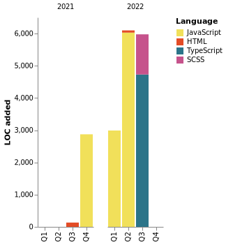

# Hi there, I'm blox! 👋
[](https://wakatime.com/@b2abe11d-3a19-4b51-8873-fb054f1233d9)
## 🚀 About Me
Nickname: blox.\
Sex: Male.

## Spotify Playing 🎧
[](https://github.com/kittinan/spotify-github-profile)

## 🔗 Links
[](https://discord.com/users/961915753681010748)

## 🛠 Skills

### Backend


### Database


### Github Recent Activity
<!--START_SECTION:activity-->
1. ❗ Opened issue [#94](https://github.com/Spotui/Spotui/issues/94) in [Spotui/Spotui](https://github.com/Spotui/Spotui)
2. 🚀 Published release [Temni](https://github.com/soudblox/nichdant-revanced/releases/tag/5) in [soudblox/nichdant-revanced](https://github.com/soudblox/nichdant-revanced)
<!--END_SECTION:activity-->

<!--START_SECTION:waka-->


**🐱 My GitHub Data** 

> 🏆 67 Contributions in the Year 2022
 > 
> 📦 2.0 kB Used in GitHub's Storage 
 > 
> 🚫 Not Opted to Hire
 > 
> 📜 4 Public Repositories 
 > 
> 🔑 6 Private Repositories  
 > 
**I'm an Early 🐤** 

```text
🌞 Morning    59 commits     ██████░░░░░░░░░░░░░░░░░░░   27.19% 
🌆 Daytime    86 commits     ██████████░░░░░░░░░░░░░░░   39.63% 
🌃 Evening    71 commits     ████████░░░░░░░░░░░░░░░░░   32.72% 
🌙 Night      1 commits      ░░░░░░░░░░░░░░░░░░░░░░░░░   0.46%

```
📅 **I'm Most Productive on Saturday** 

```text
Monday       48 commits     █████░░░░░░░░░░░░░░░░░░░░   22.12% 
Tuesday      27 commits     ███░░░░░░░░░░░░░░░░░░░░░░   12.44% 
Wednesday    20 commits     ██░░░░░░░░░░░░░░░░░░░░░░░   9.22% 
Thursday     0 commits      ░░░░░░░░░░░░░░░░░░░░░░░░░   0.0% 
Friday       8 commits      █░░░░░░░░░░░░░░░░░░░░░░░░   3.69% 
Saturday     65 commits     ███████░░░░░░░░░░░░░░░░░░   29.95% 
Sunday       49 commits     █████░░░░░░░░░░░░░░░░░░░░   22.58%

```


📊 **This Week I Spent My Time On** 

```text
⌚︎ Time Zone: Asia/Jakarta

💬 Programming Languages: 
No Activity Tracked This Week

🔥 Editors: 
No Activity Tracked This Week

💻 Operating System: 
No Activity Tracked This Week

```

**I Mostly Code in HTML** 

```text
HTML                     3 repos             ██████████░░░░░░░░░░░░░░░   42.86% 
JavaScript               3 repos             ██████████░░░░░░░░░░░░░░░   42.86% 
TypeScript               1 repo              ███░░░░░░░░░░░░░░░░░░░░░░   14.29%

```


**Timeline**

 


 Last Updated on 09/11/2022 21:19:23 UTC
<!--END_SECTION:waka-->

<!--
**soudblox/soudblox** is a ✨ _special_ ✨ repository because its `README.md` (this file) appears on your GitHub profile.

Here are some ideas to get you started:

- 🔭 I’m currently working on ...
- 🌱 I’m currently learning ...
- 👯 I’m looking to collaborate on ...
- 🤔 I’m looking for help with ...
- 💬 Ask me about ...
- 📫 How to reach me: ...
- 😄 Pronouns: ...
- ⚡ Fun fact: ...
-->
